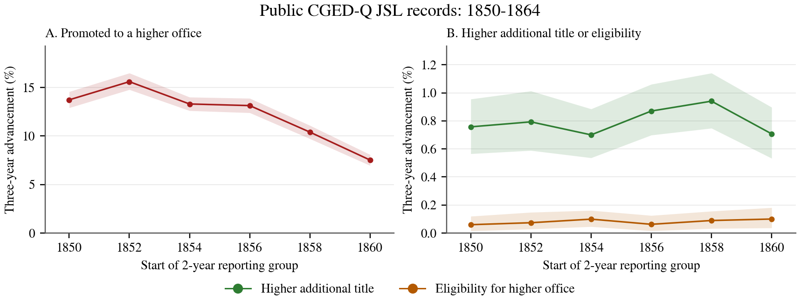

# Public-data mobility example: 1850–1864

Measure three-year advancement in office, additional title, and eligibility
using public CGED-Q Jinshenlu records to reproduce similar results as the case study of our manuscript. Each plotted point pools comparisons
starting in a two-year group.

## Run the notebook

From the repository root, with Python 3.11 or newer:

```bash
python -m pip install -e '.[analysis,notebook]'
python -m jupyterlab examples/public_mobility.ipynb
```

Select the installed environment as the kernel and **Run All**. The
[notebook](../examples/public_mobility.ipynb) downloads about 304 MiB from
[CGED-Q JSL Public Release V12](https://dataverse.harvard.edu/dataset.xhtml?persistentId=doi:10.7910/DVN/GMQWVZ&version=12.0),
checks the files, and displays the results. Later runs reuse the downloads
cached under `private/public_mobility/downloads/`. Saved tables and the figure
can also be viewed in the notebook on GitHub.

The inputs are [parsed titles](https://dataverse.harvard.edu/api/access/datafile/14356735?format=original)
and [records with person identifiers](https://dataverse.harvard.edu/api/access/datafile/14184134?format=original).
Fixed file IDs and checksums identify the release. Downloads use
`format=original` to match the published checksums.

## Command-line alternative

The notebook and [script](../examples/public_mobility.py) use the same analysis
functions. Use the notebook's cached files or download the two inputs above
and save them at the paths below. Keep the Chinese column headings.

```bash
python -m pip install -e '.[analysis]'
python examples/public_mobility.py \
  --parsed private/public_mobility/downloads/cged_q_parsed_titles_20261021.tab \
  --people private/public_mobility/downloads/cged_q_with_person_id_20260828.tab \
  --start-year 1850 --end-year 1864 --report-years 2 \
  --output private/public_mobility/1850_1864
```

These years and the two-year groups are the defaults. `--report-years 1`, `3`,
or `5` changes the grouping; the comparison interval stays three years.
Add `--overwrite` to replace existing results.

## Calculation

1. Normalize year and season codes and merge one-to-one by year, season,
   sequence number, and interpolation indicator. Use existing person IDs;
   exclude interpolated records and records missing IDs.
2. Use the released duty-office rank, falling back to a ranked base office.
   For each official and year, take the last ranked office in season/sequence
   order and the most senior additional title and eligibility.
3. Under `retained`, keep a recorded title or eligibility until the post
   changes or office rank catches up. A newly printed value replaces the
   earlier one. Alternatives use the year's printed values (`printed`) or
   limit retention to three years (`retained_3y`).
4. Compare the same official at **t and t+3**, with office ranks from 1a to 9b
   at both endpoints. Count a more senior later rank as advancement, separately
   for office, additional title, and eligibility. For the latter two, a missing
   starting value counts below an observed later value. Outcomes can overlap.
5. Divide advances by eligible comparisons. One official can contribute
   several comparisons. The point **1854** pools 1854→1857 and 1855→1858;
   groups are nonoverlapping.
6. Resample officials together with all their comparisons 1,000 times, using
   seed 20261006, to obtain pointwise 95% bootstrap intervals.

## Results

The selected **323,301 records** supply **62,913 three-year comparisons for
16,471 officials**. Under the main rule:

- Promoted to a higher office: **11.98%** (7,534 comparisons).
- Received a higher additional title: **0.800%** (503).
- Became eligible for a higher office: **0.083%** (52).



Comparisons start in 1851, 1852, and 1854–1861. The release omits 1853, so the
first two groups each contain one eligible starting year. Starts after 1861
require endpoints beyond 1864.

### Comparison with the paper

The paper covers a longer period and uses five-year groups. Its 1860 group
includes starts through 1864 and endpoints through 1867; this example ends
both observations by 1864.

## Outputs

- `window_rates.csv`: whole-period rates, counts, and intervals for all rules.
- `reporting_group_rates.csv`: rates, counts, and starting-year coverage by
  group. Five-year runs also write `five_year_rates.csv`.
- `annual_coverage.csv`: records, officials, and comparisons by year.
- `initial_year_sensitivity.csv`: rates excluding starts in the first three years.
- `provenance.json`: input hashes, software versions, settings, and exclusions.
- `component_mobility.png` and `.pdf`: the two-panel figure.

Example aggregates are in [assets/public_mobility/1850_1864/](assets/public_mobility/1850_1864/).
Cite the [paper](../README.md#citation) and [CGED-Q](https://doi.org/10.7910/DVN/GMQWVZ).
